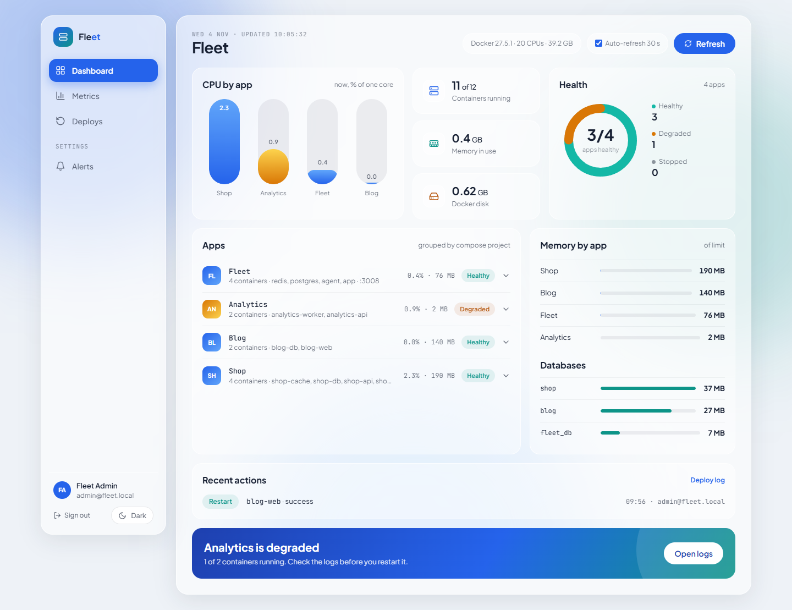
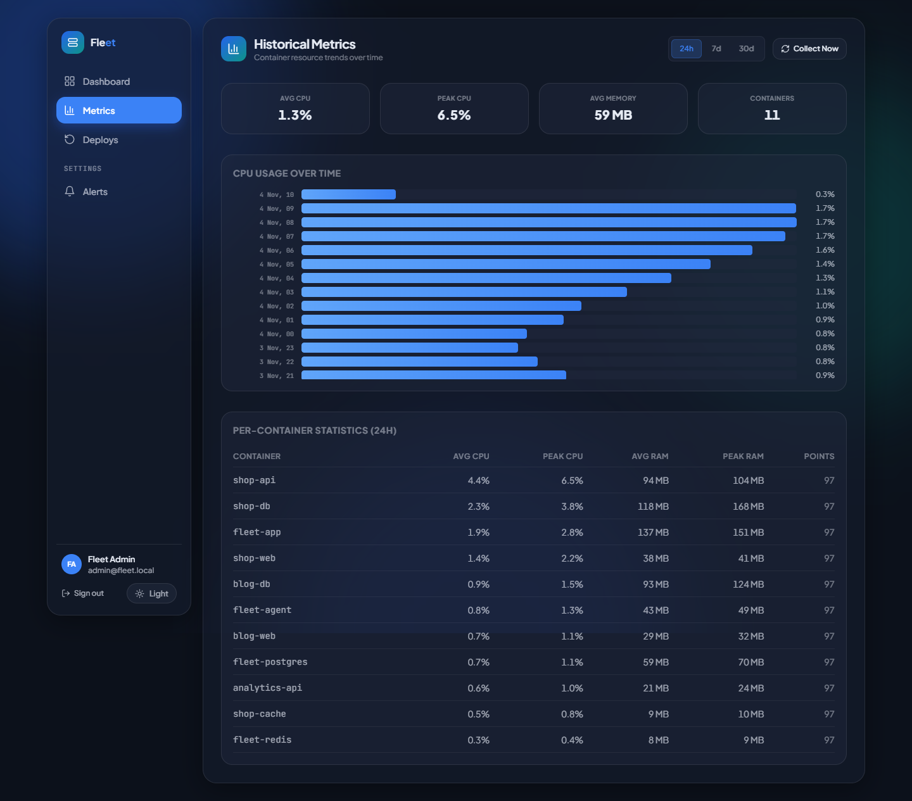
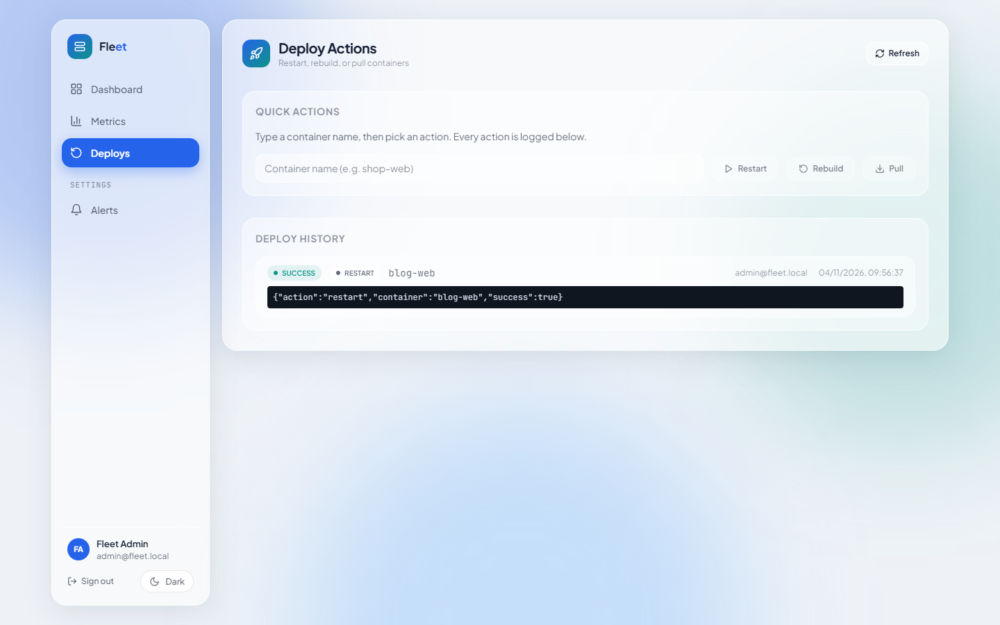

# Fleet

A small dashboard for the Docker containers on one host. It groups containers by Compose project, shows health, CPU, memory and database sizes, keeps a 30-day metrics history, restarts a container when you ask, and sends a Telegram message when a container stops or gets unhealthy.



## Why

`docker ps` answers "what is running", not "is my shop app healthy and which database is growing". Fleet reads the Docker socket next to your stack, needs no config file, and puts the answer on one screen.

## Features

- **Apps**: one row per Compose project (`com.docker.compose.project` label; otherwise the container name up to the first `-`). Each app is *Healthy* (all containers running), *Degraded* (some running) or *Stopped*. Expand a row for its containers, their status and ports.
- **Resources**: CPU per app (% of one core), memory per app, Docker disk use, and database sizes for every Postgres container (found by container name or by image).
- **Logs**: the last 20 to 500 lines of any container. A degraded app gets a banner with a link to its logs.
- **Metrics**: a sample every 5 minutes, kept for 30 days. 24 h / 7 d / 30 d views with average and peak CPU and RAM per container.
- **Actions**: restart a container, restart a Compose-managed container ("rebuild"), or pull its image. Every action is logged with the user and the result.
- **Alerts**: Telegram messages for a stopped container, a failed health check, CPU above 90 % or memory above 85 % of its limit, with a cooldown per container. The bot token is stored encrypted (AES-256-GCM).
- Light and dark theme, usable on a phone.



## Quick start

Requirements: Git, Node.js 22 or newer, Docker with Compose.

```bash
git clone https://github.com/falshaw/fleet.git
cd fleet
cp .env.example .env
```

Open `.env` and fill in the secrets: `POSTGRES_PASSWORD`, `REDIS_PASSWORD`, `AUTH_SECRET`, `FLEET_APP_PASSWORD`, `FLEET_AGENT_SECRET`, `ENCRYPTION_KEY` and `CRON_SECRET`. Put the same Postgres password into `DATABASE_URL`. Generate each value with either command:

```bash
openssl rand -hex 32
node -e "console.log(require('crypto').randomBytes(32).toString('hex'))"
```

Start the stack, then create the schema and the admin user from the host:

```bash
docker compose up -d --build
npm install --include=dev
npx prisma generate
npx prisma db push
npx prisma db seed
```

The seed prints the login: `admin@fleet.local` and a random password (or `SEED_ADMIN_PASSWORD` if you set it). Open http://localhost:3008.

`npm install --include=dev` matters: the Prisma CLI and `tsx` (used by the seed) are dev dependencies, and npm skips them when `NODE_ENV=production` or `omit=dev` is set.

The stack uses ports 3008 (app), 5441 (Postgres) and 6388 (Redis), all bound to `127.0.0.1`. Stop it with `docker compose down` (add `-v` to delete the data).

### Telegram alerts

Create a bot with [@BotFather](https://t.me/BotFather), send it a message, and read your chat ID from `https://api.telegram.org/bot<token>/getUpdates`. Enter both under **Alerts**, pick the alert types, and use **Send test** to check.

## Configuration

| Variable | Purpose |
|---|---|
| `FLEET_AGENT_SECRET` | Shared secret between the app and the agent |
| `CRON_SECRET` | Shared secret between `fleet-cron` and `/api/metrics/collect` |
| `ENCRYPTION_KEY` | Encrypts the Telegram bot token at rest |
| `FLEET_APP_PASSWORD` | Password of the least-privilege database user the app connects as |
| `DATABASE_URL` | Owner connection used only by the Prisma CLI and the seed on the host |

To give an app a fixed name, colour or URL instead of the automatic grouping, add it to `FLEET_APPS` in `src/lib/fleet-apps.ts`.

## Architecture

| Container | Role |
|---|---|
| `fleet-app` | Next.js 16 dashboard and API |
| `fleet-agent` | Python (Flask + gunicorn) service that talks to Docker; the only container with the Docker socket |
| `fleet-cron` | Calls `/api/metrics/collect` every 5 minutes (metrics history and alerts) |
| `fleet-postgres` | Users, metrics history, action log, alert settings |
| `fleet-redis` | Login rate limiting |

### Security

The Docker socket gives root-equivalent access to the host, so it is contained:

- Only `fleet-agent` mounts it, read-only, with `no-new-privileges`, all capabilities dropped and a read-only root file system.
- The agent publishes no port. The app reaches it on an internal network with `FLEET_AGENT_SECRET`.
- The agent exposes a fixed set of operations (list, stats, logs, database size, restart, pull). Container names are validated; it cannot run arbitrary commands.
- The app requires a login for every page and API route except the login page, `/api/auth` and `/api/health`; `/api/metrics/collect` takes either a session or the cron secret. State-changing requests are checked against the `Origin` header.

Run Fleet on a host you control, and keep port 3008 on `127.0.0.1` or behind a reverse proxy with TLS.

Stack: Next.js 16, React 19, Tailwind CSS 4, Prisma 7 (PrismaPg adapter), Auth.js 5, Postgres 16, Redis 8, Python 3.12, docker-py.



## Development

```bash
npm install --include=dev
npx prisma generate
npm run dev        # needs Postgres, Redis and the agent from the compose stack
npm test           # Vitest
npm run lint
npx tsc --noEmit
```

## Limits

- One Docker host. Fleet does not manage Swarm, Kubernetes or remote hosts.
- "Rebuild" restarts the container; a real image rebuild still needs `docker compose up -d --build` on the host.
- Database sizes cover Postgres only.
- Alert cooldowns are kept in memory and reset when the app restarts.

## License

MIT, see [LICENSE](LICENSE).
